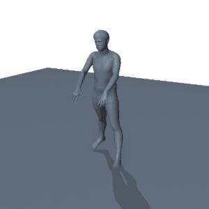

# SMPL Animation Exporter: FBX, glTF and USD

[](https://www.python.org/)
[](LICENSE)
[](#output-formats)

Turn [SMPL](https://smpl.is.tue.mpg.de/) pose sequences, such as those in the [SURREAL](https://www.di.ens.fr/willow/research/surreal/) dataset, into **rigged, skinned and animated 3D characters**. The result opens in Blender, Maya, Unity, Unreal, web viewers or AR apps.

<p align="center">
  
  <br>
  <sub>A raw SURREAL sequence (<code>animations/104_03_c0003_info.mat</code>) applied to the SMPL template, exported to glTF and rendered in Blender.</sub>
</p>

Every exported file contains:

- the body **mesh**: the SMPL template, or your own body in SMPL topology
- a **24-joint skeleton** following the SMPL hierarchy, plus a virtual `Root`
- per-vertex **skin weights** and a T-pose **bind pose**
- the **animation**: one rotation key per joint and frame, timed at the source frame rate

---

## Contents

- [Quick start](#quick-start)
- [Installation](#installation)
- [Usage](#usage)
- [Input data](#input-data)
- [Output formats](#output-formats)
- [How it works](#how-it-works)
- [Troubleshooting](#troubleshooting)
- [Development](#development)
- [License](#license) and [citation](#citation)

---

## Quick start

glTF and USD export need only pip packages, so this is the fastest way to try the project:

```bash
git clone https://github.com/PietroMsn/smpl-animation-exporter.git
cd smpl-animation-exporter
python -m venv .venv
# Windows: .venv\Scripts\activate    macOS/Linux: source .venv/bin/activate
pip install -r requirements.txt
```

Then download the SMPL model (free registration, see [SMPL model](#3-smpl-model)) into `models/` and run:

```bash
python main.py animations/104_03_c0003_info.mat --up-axis z -o output/104_03.glb
```

Open `output/104_03.glb` in Blender (*File → Import → glTF 2.0*) or drag it into an online glTF viewer, then press play.

---

## Installation

### 1. Python

Python **3.9 or newer**. To export FBX, use the Python version supported by your build of the Autodesk FBX Python SDK (see step 4).

### 2. Python packages

```bash
pip install -r requirements.txt
```

| Package | Used for |
|---|---|
| `numpy`, `scipy` | Everything (glTF export needs nothing else) |
| `usd-core` | USD export |
| `pytest` | Running the tests |

### 3. SMPL model

All SMPL data (template mesh, triangles, skin weights, joint regressor) is read from the **official SMPL model file**. This repository ships none of it, because the SMPL license does not allow redistribution.

1. Register on [smpl.is.tue.mpg.de](https://smpl.is.tue.mpg.de) (free for research) and download the model.
2. Put one of the model files in a `models/` folder at the project root. For example: `basicmodel_m_lbs_10_207_0_v1.1.0.pkl` (male), `basicmodel_f_lbs_10_207_0_v1.1.0.pkl` (female) or `basicmodel_neutral_lbs_10_207_0_v1.1.0.pkl` (neutral).

The exporter picks the first model it finds in `models/`, preferring male, then neutral, then female. To choose a specific one, pass `--model path/to/model.pkl`.

The original Python 2 `.pkl` files load directly; **chumpy is not needed**. `.npz` files with the same arrays (`v_template`, `f`, `weights`, `J_regressor`), such as `SMPL_NEUTRAL.npz`, also work.

### 4. Autodesk FBX Python SDK (FBX export only)

The FBX SDK is not on PyPI. Skip this step if you only need glTF or USD.

1. Download the **FBX Python SDK** for your OS from the [Autodesk FBX SDK page](https://aps.autodesk.com/developer/overview/fbx-sdk).
2. Install the wheel it contains. The `cp3XX` tag in its name is the Python version it needs (e.g. `cp310` = Python 3.10):

   ```bash
   pip install fbx-<version>-cp3XX-none-<platform>.whl
   ```

3. Check it works: `python -c "import fbx"`.

---

## Usage

```bash
python main.py <pose_mat> [mesh_mat] [options]
```

| Argument | Description |
|---|---|
| `pose_mat` | `.mat` file with a `pose` array of shape (72, frames) |
| `mesh_mat` | Optional. A `.mat` file with your own T-pose body in SMPL topology (see [Custom mesh](#custom-mesh-mesh_mat)). Default: the SMPL template from the model file |
| `-o`, `--output` | Output file. Its extension selects the format: `.fbx`, `.glb`, `.gltf`, `.usd`, `.usda`, `.usdc` or `.usdz`. Default: `output/<pose file name>.<ext>` |
| `-f`, `--format` | `fbx`, `gltf` or `usd`, when `--output` is not given. Default: `fbx` |
| `--up-axis` | Axis pointing up in the pose data, `y` or `z`. **Use `z` for raw SURREAL files**, otherwise the character lies on its back. Default: `y` |
| `--model` | SMPL model file (`.pkl` or `.npz`). Default: the first SMPL model found in `models/` |
| `-s`, `--scale` | Scale factor for the mesh. SMPL is in metres. Default: `1` |
| `--fps` | Frame rate of the animation. Default: `30` (SURREAL's frame rate) |
| `--start`, `--end` | Export only frames `start` to `end - 1`. Default: all frames |

Output folders are created automatically.

### Examples

```bash
# Raw SURREAL sequence → binary glTF (single file)
python main.py animations/104_03_c0003_info.mat --up-axis z -o output/104_03.glb

# Same sequence → FBX, frames 0-49 only, with the female model
python main.py animations/104_03_c0003_info.mat --up-axis z --end 50 --model models/basicmodel_f_lbs_10_207_0_v1.1.0.pkl -o output/104_03.fbx

# Y-up sequence → USD (.usda = text, .usdc = binary, .usdz = AR package)
python main.py animations/danza1.mat -o output/dance.usdc

# Your own body mesh instead of the SMPL template
python main.py animations/danza1.mat meshes/MESH1_SMPL.mat -o output/dance.glb

# Format only: writes output/danza1.glb
python main.py animations/danza1.mat -f gltf
```

### Inspecting a pose file

```bash
python attach_anim.py animations/104_03_c0003_info.mat
```

This prints the shape and contents of the `pose` array.

---

## Input data

### Pose sequences (`pose_mat`)

A MATLAB `.mat` file with a `pose` array of shape **(72, F)**: one column per frame, holding the 24 SMPL joint rotations as axis-angle (Rodrigues) vectors in radians. The first 3 values are the global orientation of the pelvis. Other keys in the file are ignored.

- **SURREAL**: the `*_info.mat` files of the [SURREAL dataset](https://www.di.ens.fr/willow/research/surreal/) (request access on the project page) work as they are. Their poses are expressed in a **Z-up** world, so pass `--up-axis z`.
- **Your own data**: any SMPL pose sequence works. Save it with `scipy.io.savemat("my_anim.mat", {"pose": poses.T})`, where `poses` is a NumPy array of shape (F, 72).

### SMPL model (`--model`)

The model file provides everything else: the T-pose template mesh, its triangles, the linear blend skinning weights and the joint regressor that places the skeleton inside the mesh. See [Installation, step 3](#3-smpl-model).

### Custom mesh (`mesh_mat`)

By default the character is the SMPL template. To animate another body, for example a scan registered to SMPL, pass a `.mat` file with that body in **T-pose**:

- `VERT`: (6890, 3) vertex positions, in the same vertex order as SMPL
- `TRIV` (optional): (13776, 3) triangles, 1-based (MATLAB convention). If it is missing, the SMPL triangles are used.

The skin weights always come from the SMPL model, and the joint positions are computed from your mesh.

To save a mesh you already have as NumPy arrays:

```python
import scipy.io as sio
sio.savemat("my_mesh.mat", {"VERT": vertices})  # (6890, 3) float array
```

### Sample data in this repository

- `animations/`: pose sequences.
  - The `*_info.mat` files come from SURREAL and are **Z-up**.
  - `danza1.mat`, `danza2.mat`, `corsa1.mat`, `pugni1.mat`, `arms1.mat` and `info_camminata*.mat` are already Y-up.
  - For any other file: if the character lies down, add `--up-axis z`.
  - `animations/anim/` also contains SURREAL videos, depth and segmentation maps for reference.
- `meshes/`: example custom bodies in SMPL topology, in metres. Some of them (e.g. `michael*_SMPL.mat`, `wetaSMPLConn.mat`) use a different orientation or scale and may need `--scale`. They are optional: without a mesh argument the SMPL template is used.

<!-- TODO (maintainer): document where the sample meshes in meshes/ come from and under which license. -->

---

## Output formats

| Format | Extensions | Extra requirement | Typical use |
|---|---|---|---|
| **FBX** | `.fbx` | Autodesk FBX Python SDK | Maya, 3ds Max, MotionBuilder, Unity, Unreal |
| **glTF 2.0** | `.glb` (one file), `.gltf` (+ `.bin`) | none | Web (three.js, Babylon.js), Blender, Godot, game engines |
| **OpenUSD** | `.usda` (text), `.usdc` (binary), `.usd`, `.usdz` (AR) | `usd-core` | NVIDIA Omniverse, Houdini, Blender, Apple AR Quick Look |

All formats are written **Y-up**, with the mesh units unchanged (metres for SMPL).

---

## How it works

```
pose .mat ───────┐
SMPL model ──────┼─► rig.py ──► Rig ──┬─► exporters/fbx_export.py   ──► .fbx
mesh .mat (opt.) ┘   (one format-     ├─► exporters/gltf_export.py  ──► .glb / .gltf
                      independent)    └─► exporters/usd_export.py   ──► .usd*
```

1. **`rig.py`** loads every input into a single `Rig` object:
   - **Mesh and skin weights**: from the SMPL model file, or the mesh from `mesh_mat`.
   - **Rest skeleton**: the SMPL joint regressor gives the position of each joint, and each position is stored relative to the joint's parent.
   - **Animation**: a local rotation per joint and frame. With `--up-axis z`, the pelvis rotation is turned -90° about X.
2. **An exporter** writes that rig in its own format:
   - **FBX** (`fbx_export.py`): Euler XYZ rotation curves in degrees, one skin cluster per joint and an FBX bind pose. The pelvis uses linear interpolation and also gets translation keys; the other joints use cubic interpolation.
   - **glTF** (`gltf_export.py`, pure NumPy):
     - one node per joint, and a skin with inverse bind matrices
     - up to 4 influences per vertex in each `JOINTS_n`/`WEIGHTS_n` set
     - quaternion rotation channels with `LINEAR` (spherical) interpolation
     - vertex normals
   - **USD** (`usd_export.py`, UsdSkel):
     - a `SkelRoot` containing a `Skeleton` with bind and rest transforms
     - a `SkelAnimation` with per-frame quaternions
     - a `Mesh` bound to the skeleton through `UsdSkel.BindingAPI`
     - the stage time codes follow `--fps`

Each exporter is imported only when it is used, so missing FBX or USD libraries never get in the way of the other formats.

### Project layout

```
.
├── main.py              # Command-line interface
├── rig.py               # Builds the format-independent Rig
├── smpl_model.py        # Loads the official SMPL model files (no chumpy)
├── smpl_math.py         # Rotation and joint-position math
├── geometry.py          # Reads a custom mesh from a .mat file
├── exporters/
│   ├── fbx_export.py
│   ├── gltf_export.py
│   ├── usd_export.py
│   └── skinning.py      # Shared helpers (influences, quaternions, normals)
├── attach_anim.py       # Prints the pose array of a .mat file
├── animations/          # Sample pose sequences
├── meshes/              # Optional example bodies
├── docs/                # README images
└── tests/
```

### Known limitations

- The **global translation** of the body (`trans` in SURREAL) is not exported: the character moves in place.
- **Body shape** parameters (`shape` / `beta`) are not applied. The body is the SMPL template or the mesh you pass, and the joint positions are computed from it.
- No materials or textures.
- FBX export has been tested with a stand-in for the SDK. glTF and USD are checked against an independent skinning computation and in Blender.

---

## Troubleshooting

| Problem | Fix |
|---|---|
| The character lies on its back | The pose data is Z-up (all raw SURREAL files). Add `--up-axis z`. |
| `Cannot export to FBX: No module named 'fbx'` | Install the FBX Python SDK ([step 4](#4-autodesk-fbx-python-sdk-fbx-export-only)), or export to `.glb` / `.usdc` instead. |
| `Module use of python27.dll conflicts with this version of Python` | Old Python 2 binaries (`fbx.pyd`, `fbxsip.pyd`, `cv2.pyd`) are left in the project folder from earlier versions. Delete them. |
| `Cannot export to USD: No module named 'pxr'` | `pip install usd-core` |
| `No SMPL model found in models/` | Download the SMPL model ([step 3](#3-smpl-model)) and put it in `models/`, or pass `--model path/to/model.pkl`. |
| `... has N vertices; a mesh in SMPL topology has 6890` | Your custom mesh is not in SMPL topology. Omit `mesh_mat` to use the SMPL template. |
| The character is huge or tiny | Fix the mesh units with `--scale`. For example, use `--scale 0.01` for a mesh in centimetres. |
| The animation plays too fast or too slow | Set `--fps` to the frame rate of your source data. |

---

## Development

Run the tests:

```bash
python -m pytest tests
```

The tests need neither the FBX SDK nor the SMPL model; they use a synthetic model with the same structure:

- **SMPL loading**: a pickle laid out like the official files, chumpy objects included, is created and read back.
- **FBX**: when the SDK is not installed, a small fake `fbx` module stands in for it and the whole pipeline runs on the sample data.
- **glTF and USD**: the exported files are read back, the mesh is skinned at several frames and the result is compared with an independent linear blend skinning implementation (`tests/reference.py`). For USD, `UsdSkel` does the skinning itself. The USD tests are skipped if `usd-core` is missing.

**Adding a format**: create `exporters/<name>_export.py` with an `export(rig, output_path)` function, register it in `FORMATS` and `EXTENSIONS` in `exporters/__init__.py`, and add a test that reads the file back.

Issues and pull requests are welcome.

---

## License

The **code** in this repository is released under the [MIT License](LICENSE).

The MIT License does not cover the data it works with:

- **SMPL** is subject to the [SMPL Model License](https://smpl.is.tue.mpg.de/modellicense.html). No SMPL model data is included in this repository; you download it yourself.
- **SURREAL** data (the `*_info.mat` files and `animations/anim/`) is subject to the [SURREAL license](https://www.di.ens.fr/willow/research/surreal/data/license.html).

Check those licenses before any commercial use. Exported files contain SMPL-derived data (mesh, weights), so the SMPL license applies to them too.

---

## Citation

If you use this exporter with SMPL or SURREAL data in academic work, please cite the original papers:

```bibtex
@article{SMPL:2015,
  author  = {Loper, Matthew and Mahmood, Naureen and Romero, Javier and Pons-Moll, Gerard and Black, Michael J.},
  title   = {{SMPL}: A Skinned Multi-Person Linear Model},
  journal = {ACM Transactions on Graphics (Proc. SIGGRAPH Asia)},
  volume  = {34},
  number  = {6},
  pages   = {248:1--248:16},
  year    = {2015}
}

@inproceedings{varol17_surreal,
  author    = {Varol, G{\"u}l and Romero, Javier and Martin, Xavier and Mahmood, Naureen and Black, Michael J. and Laptev, Ivan and Schmid, Cordelia},
  title     = {Learning from Synthetic Humans},
  booktitle = {CVPR},
  year      = {2017}
}
```

### Acknowledgements

- [SMPL](https://smpl.is.tue.mpg.de/), Max Planck Institute for Intelligent Systems
- [SURREAL](https://www.di.ens.fr/willow/research/surreal/), Inria / École Normale Supérieure
- [Autodesk FBX SDK](https://aps.autodesk.com/developer/overview/fbx-sdk), [OpenUSD](https://openusd.org/) (Pixar), [glTF](https://www.khronos.org/gltf/) (Khronos Group)
